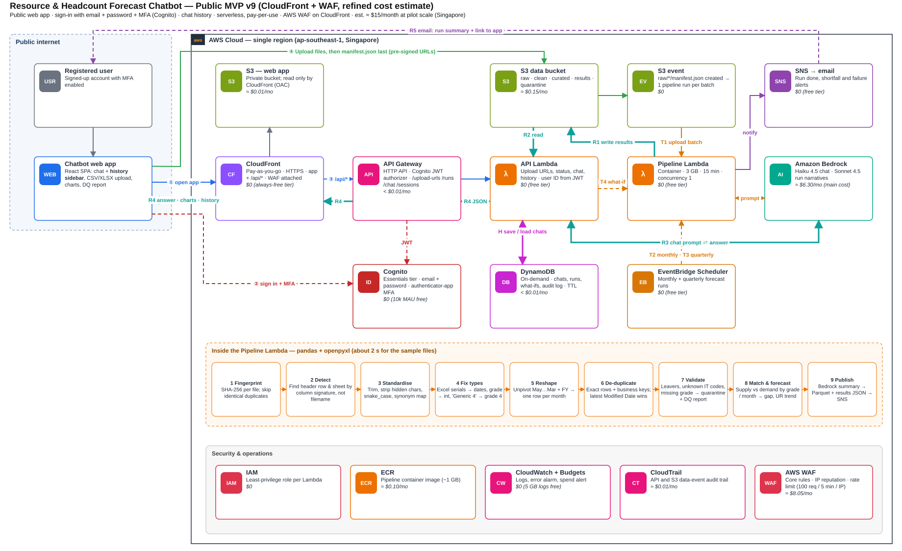
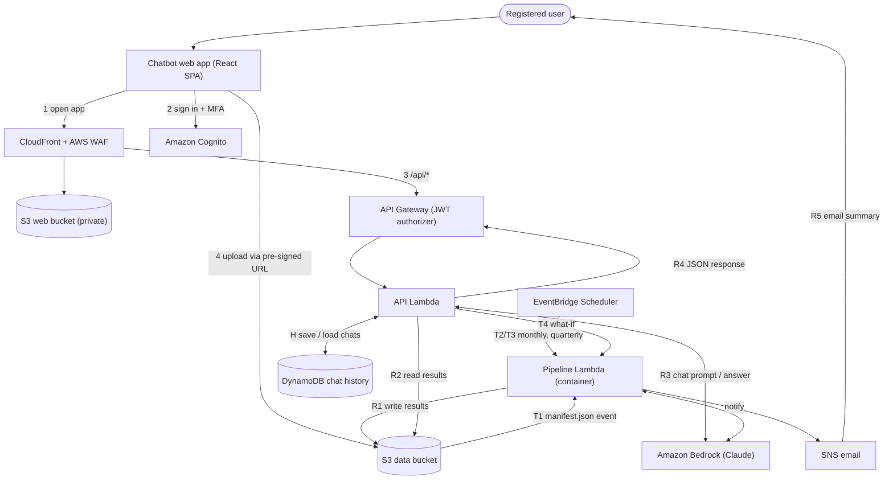

# LPS-Beacon

**Resource Planning Forecast Chatbot** — an AI-powered assistant that turns messy project, pipeline, workforce and
financial planning files into headcount forecasts, supply-versus-demand analysis, resource matching, profit and loss
views and monthly forecast reports, all through a natural-language chat interface.

> Upload your planning files, ask questions in plain English, and get cleaned data, forecasts, charts and
> downloadable reports back in the same conversation.



---

## Table of contents

1. [Project status](#project-status)
2. [Collaborating](#collaborating)
3. [What the chatbot does](#what-the-chatbot-does)
4. [Capabilities and features](#capabilities-and-features)
5. [Roles and access](#roles-and-access)
6. [Example conversations](#example-conversations)
7. [Architecture](#architecture)
8. [How data flows](#how-data-flows)
9. [Data pipeline: cleaning and standardisation](#data-pipeline-cleaning-and-standardisation)
10. [Forecasting approach](#forecasting-approach)
11. [Triggers](#triggers)
12. [Security and access control](#security-and-access-control)
13. [Data storage layout](#data-storage-layout)
14. [API reference](#api-reference)
15. [Chat history model](#chat-history-model)
16. [Estimated cost](#estimated-cost)
17. [Design decisions](#design-decisions)
18. [Getting started](#getting-started)
19. [Repository layout](#repository-layout)
20. [Data handling](#data-handling)
21. [Known limitations](#known-limitations)
22. [Roadmap](#roadmap)

---

## Project status

This repository currently contains the **web app** and the **design documents**. The AWS backend described below is
designed but not yet in this repository.

| Area | Status | Where |
|---|---|---|
| Sign-in with Amazon Cognito, plus practice accounts for offline work | Implemented | `frontend/` |
| Chat screen (suggested questions, new chat, session ID) | Implemented, answers are mocked until the backend exists | `frontend/` |
| Upload screen (CSV/Excel up to 20 MB, pre-signed S3 upload, per-file status) | Implemented, mocked until the backend exists | `frontend/` |
| Dashboard (charts built from the capacity plan) | Implemented; shows sample data only when `VITE_USE_SAMPLE_PLAN=true` | `frontend/` |
| Analysis screen (capacity plan with editable input cells, grouped by quarter and financial year, CSV download) | Layout implemented, fields empty until the backend generates the plan | `frontend/` |
| Backend contract the web app expects | Documented | [`frontend/API_CONTRACT.md`](frontend/API_CONTRACT.md) |
| API Lambda, Pipeline Lambda, chat agent (Bedrock Converse with tool use), schedules, notifications, infrastructure | Designed | [Architecture](#architecture) |
| Chat history sidebar, charts in chat, what-if scenarios, report downloads | Designed | [Capabilities](#capabilities-and-features) |
| Authenticator-app (TOTP) MFA setup inside the sign-in form | Not supported yet | [Known limitations](#known-limitations) |

---

## Collaborating

The GitHub repository is the single source of truth. Nobody needs to zip and send files: change the code, push, and
everyone else pulls the update.

| I want to… | Do this |
|---|---|
| **Edit code in the browser and see it run, with nothing to install** | Open the repository, choose **Code → Codespaces → Create codespace**. The app starts automatically in mock mode with a live preview that updates as you type. |
| **Make a quick edit to a file** | Open the file on GitHub and press the pencil icon, or press `.` for the browser editor. Commit to a new branch and open a pull request. (This edits files; it does not run the app.) |
| **Work on my own computer** | Clone the repository, run `npm ci` and `npm run dev` in `frontend/`. Save a file and the browser updates instantly. |
| **See the latest version without installing anything** | Turn on the optional live preview (see [CONTRIBUTING.md](CONTRIBUTING.md#optional-live-preview-for-everyone)), then open the preview link. |
| **Get the latest changes someone else made** | `git pull` (or **Fetch / Pull** in GitHub Desktop). |

Every push and pull request is checked automatically (lint, type-check, build). Full instructions are in
[CONTRIBUTING.md](CONTRIBUTING.md).

---

## What the chatbot does

LPS-Beacon is the single front door for resource planning work. Instead of manually reconciling spreadsheets, a
planner opens the web app, signs in, drops in their files and talks to the assistant.

Behind the chat window, serverless AWS services will:

1. **Receive** the uploaded files (typically 10–12 CSV/XLSX files per batch).
2. **Clean and standardise** them: duplicates, shifted headers, inconsistent names, Excel date serials and wide
   month columns are handled automatically.
3. **Match** demand (quote lines, resource plans, project pipeline) against supply (staff lists, HR headcount,
   utilisation) by grade, month and location.
4. **Forecast** demand, headcount and capacity with statistical models.
5. **Explain** the results with a large language model (Amazon Bedrock) in plain language, including the
   assumptions behind the numbers.
6. **Return** charts, tables, a data-quality report and downloadable reports to the chat, and email a summary when
   scheduled runs finish.

The assistant is the **Resource Planning Forecast Agent**: a Bedrock-hosted Claude model that decides which tool to
call (run a forecast, fetch results, run a what-if) while the numerical work is done by deterministic Python code.
This keeps forecasts repeatable and auditable; the model explains and reasons over the numbers rather than
computing them.

The agent loop runs inside the API Lambda using the Bedrock Converse API with tool use: the Lambda sends the question,
the recent chat history and the tools the user's role may use; Claude asks for a tool; the Lambda runs it and sends
the result back; Claude answers. There is no separate agent service (Bedrock Agents or AgentCore), so the role
check, the tools, the guardrail check and the chat history all live in one place.

---

## Capabilities and features

The tables below describe the **target design**. See [Project status](#project-status) for what exists today.

### 1. Conversational interface

| Feature | Description |
|---|---|
| Natural-language chat | Ask for forecasts, comparisons, explanations and what-if scenarios in everyday language. |
| Suggested questions | One-click starter questions. |
| Rich answers | Replies include rendered charts, forecast tables and data-quality summaries, not just text. |
| Chat history sidebar | Every conversation is saved per user and listed newest-first; open any past chat to reload its messages and re-render its charts. |
| Auto-titled chats | The first message generates a short title (for example, "Grade 7 shortfall Q3"). |
| Rename and delete chats | Users manage their own history; chats expire automatically under a configurable retention period. |
| Run references | Answers cite the forecast run they came from, so every number can be traced back. |

### 2. File upload and ingestion

| Feature | Description |
|---|---|
| Batch uploads | Drag and drop 10–12 CSV/XLSX files at once; the batch is treated as one unit of work. |
| Direct-to-storage upload | Files go straight from the browser to S3 using short-lived pre-signed URLs, so large files never pass through the API. |
| Validation before upload | File type (CSV, XLSX, XLS) and size (20 MB each) are checked in the browser and again on the server. |
| Per-file status | Each file shows ready, uploading, done or error, and the queue survives moving between pages. |
| One run per batch | A `manifest.json` written last signals that the batch is complete, so a 12-file upload triggers one pipeline run, not twelve. |
| Duplicate-file detection | Identical files (matched by SHA-256 fingerprint) are skipped. |
| Format-agnostic detection | Sheets and header rows are found by column signature, not by file name or fixed position. |

### 3. Data cleaning and standardisation

The pipeline is built for noisy planning data, including:

- Header rows that are not on row 1, and extra title or "data as of" rows.
- Several small tables side by side on one sheet.
- Wide month layouts (May…March columns plus a fiscal-year column) that need unpivoting to one row per month.
- Excel serial dates, mixed date formats and hidden or zero-width characters in headers.
- Inconsistent naming (for example "Generic 4" and "Generic Resource 4").
- Exact and business-key duplicates, resolved by the latest modified date.
- Leavers, unknown IT codes and missing grades, which are quarantined rather than silently dropped.

Every run produces a **data-quality report** (what was removed, what was quarantined and why) that appears in the
chat and is passed to the model, so the assistant can say "the Grade 7 gap excludes 12 people with a missing grade".

### 4. Forecasting and analysis

| Capability | What you get |
|---|---|
| **Demand forecast** | Monthly resource demand by grade, skill and location from quote lines, resource plans and pipeline data. |
| **Headcount forecast** | Projected headcount requirement by month and quarter. |
| **Resource matching** | Supply-versus-demand comparison by grade, month and city, with the gap and the people or roles driving it. |
| **Capacity analysis** | Capacity and utilisation trends, bench cost shown separately from project cost, and shortfall or surplus highlights. |
| **Baseline and forecast P&L** | Project margin from ABCD revenue less resource cost, with bench cost shown separately, then a forecast P&L with stated assumptions. |
| **Monthly and quarterly forecasts** | Scheduled runs on the latest cleaned data, including a quarter-horizon view. |
| **What-if scenarios** | Change an assumption in chat (add hires, slip a project, change a start date) and get the result as a delta against the baseline. |
| **Stated assumptions** | Forecasts list the assumptions and data limits behind them; thin history is flagged, and synthetic data, where used, is clearly marked. |

### 5. Reports and notifications

| Feature | Description |
|---|---|
| Monthly forecast report | Excel and CSV outputs written to storage for each run (PDF is on the roadmap). |
| In-chat results | The same forecast table and charts, rendered in the conversation. |
| Email notifications | Run complete, shortfall detected, stale-data reminder and failure alerts, sent through Amazon SNS with a link back to the app. |
| Audit trail | Accept, edit and reject actions on a forecast are logged with user and timestamp. |

### 6. Security and administration

- Email and password sign-in through Amazon Cognito, with **required authenticator-app MFA** in the target design.
- Two kinds of account (Cognito groups `restricted` and `finance_hr`, see [Roles and access](#roles-and-access)). The web
  app hides pages by role, but access control is enforced by the backend.
- Per-user data isolation: uploads and chat history are scoped by the verified user ID.
- AWS WAF in front of the app, least-privilege IAM per function, encrypted private buckets and a full CloudTrail
  audit trail.
- Per-user daily chat limit and a monthly spend alert to keep model costs predictable.

---

## Roles and access

There are two kinds of account. The role comes from the user's Cognito group: `restricted` or `finance_hr`
(if someone is in both, Finance/HR wins).

| Page | Restricted (mainly project managers) | Finance/HR |
|---|:---:|:---:|
| Chat | Yes (limited questions, see below) | Yes |
| Dashboard | No | Yes |
| Upload files | No | Yes |
| Analysis | No | Yes |

The rules are set in one place, `LPS-Beacon-Frontend/src/auth/permissions.ts`. Screen rules are a convenience only. The backend
must withhold cost and capacity plan data from anyone outside the `finance_hr` group, and the chat backend should apply a
Bedrock guardrail to `restricted` users to limit the questions they can ask.

---

## Example conversations

```
You:    Upload complete — 11 files.
Beacon: Cleaned 11 files. Removed 57 duplicate rows and 1 duplicate file, quarantined
        55 records with unknown IT codes. Forecast is ready.

You:    Where are we short on headcount next quarter?
Beacon: Grade 7 is short by 6 FTE in Feb–Mar, mainly driven by two projects starting in
        January. Grades 4–5 are in surplus by 3 FTE. [chart] [table]

You:    What if three Grade 7 hires start in January and Project X slips two months?
Beacon: The Grade 7 gap closes in February instead of April, but bench cost rises by
        about 8% in Q4. Compared with the baseline: [delta chart]

You:    Why did the gap grow in March?
Beacon: Two quote lines (Q-1042, Q-1057) start in March, adding 4 FTE of Grade 7
        demand while three people on the staff list have leave dates before then.

You:    Send me the monthly report.
Beacon: Here is the Excel report for this run. [download]
```

These examples are illustrative. The numbers and project names are not real data.

---

## Architecture

The design is deliberately small: **serverless, pay-per-use, nothing running between requests.**



The full diagram with every service, the nine pipeline steps and cost tags is in
[`docs/architecture.svg`](docs/architecture.svg). The editable version is
[`docs/architecture.drawio`](docs/architecture.drawio) (open it in [draw.io](https://app.diagrams.net)).

### Components

| Component | Role |
|---|---|
| **Chatbot web app** | React single-page app: chat, history sidebar, file upload, dashboard, Analysis (capacity plan). Hosted in a private S3 bucket. |
| **Amazon CloudFront + AWS WAF** | HTTPS entry point for both the app and `/api/*`. WAF filters bad IPs, common exploits and request floods. |
| **Amazon Cognito** | Sign-up, sign-in and required MFA; issues the JWT used on every API call. |
| **API Gateway (HTTP API)** | Routes API calls; the JWT authorizer rejects unauthenticated calls. |
| **API Lambda** | Fast request handler: pre-signed URLs, run status, chat answers, chat history. Takes the user ID only from the verified token. |
| **Pipeline Lambda** | Container-image function (pandas, openpyxl, statsmodels): cleaning, matching, forecasting, report generation. 3 GB, up to 15 minutes, concurrency 1, idempotent by batch ID. |
| **Amazon S3 (data)** | `raw/`, `clean/`, `curated/`, `results/`, `reports/`, `quarantine/` prefixes. Block Public Access on. |
| **Amazon Bedrock** | Claude Haiku 5.5 for chat, Claude Sonnet 5.5 for run narratives, called through cross-Region inference profiles. Receives aggregates and summaries, not raw rows. |
| **Amazon DynamoDB** | Chat sessions and messages, run records, what-if scenarios, audit log; on-demand with TTL. |
| **EventBridge Scheduler** | Monthly and quarterly forecast triggers. |
| **Amazon SNS** | Email notifications for completed runs, alerts and failures. |
| **IAM, CloudWatch, CloudTrail, ECR** | Least-privilege roles, logs and alarms, audit trail, container image storage. |

---

## How data flows

Numbers on the architecture diagram map to these steps.

**Requests and uploads**

| Step | What happens |
|---|---|
| 1 | The user opens the app through CloudFront; WAF filters the traffic. |
| 2 | The user signs in with email, password and an authenticator-app code; Cognito returns a JWT. |
| 3 | The app calls `/api/*` with the JWT; API Gateway validates it. |
| 4 | The browser uploads files to `raw/{user_sub}/{batch_id}/` using pre-signed URLs, writing `manifest.json` last. |

**Results back to the user**

| Step | What happens |
|---|---|
| **R1** | The Pipeline Lambda writes `results/{run_id}.json` (forecast table, supply-versus-demand gaps, chart specs, narrative), curated Parquet, reports and the data-quality report to S3. |
| **R2** | The API Lambda reads the latest results for run status, charts and chat context. |
| **R3** | The API Lambda sends the question plus a results summary to Bedrock, which returns the answer. |
| **R4** | The JSON response returns API Lambda → API Gateway → CloudFront → web app, which renders the reply, charts and tables. |
| **R5** | Scheduled runs and alerts email a summary and link through SNS. |

**Chat history**

| Step | What happens |
|---|---|
| **H1** | On page load, `GET /sessions` lists the user's chats from DynamoDB for the sidebar. |
| **H2** | Each `/chat` call saves the question and answer, with any run IDs. |
| **H3** | Opening a past chat reloads its messages and re-renders its charts from `results/`. |

---

## Data pipeline: cleaning and standardisation

The Pipeline Lambda runs these steps in order. For typical batches (a few MB across several files) the whole run
takes seconds to a minute.

| # | Step | What it does |
|---|---|---|
| 1 | **Fingerprint** | SHA-256 per file; identical duplicates are skipped. |
| 2 | **Detect** | Finds the right sheet and header row by column signature. |
| 3 | **Standardise** | Trims text, strips hidden characters, converts headers to snake_case, applies a synonym map. |
| 4 | **Fix types** | Excel serials to dates, grade to integer, "Generic 4" to grade 4. |
| 5 | **Reshape** | Unpivots month columns plus fiscal year into one row per month. |
| 6 | **De-duplicate** | Removes exact duplicates and business-key duplicates; the latest modified date wins. |
| 7 | **Validate** | Leavers, unknown IT codes and missing grades go to `quarantine/` with the reason, and into the data-quality report. |
| 8 | **Match and forecast** | Supply versus demand by grade and month; demand, headcount, capacity and P&L forecasts. |
| 9 | **Publish** | Bedrock summary, curated Parquet, results JSON, Excel/CSV report, then an SNS notification. |

**Why Python in Lambda instead of AWS Glue or Athena?** The data is small, pandas reads `.xlsx` directly, Lambda
starts instantly and costs fractions of a cent per run, and there are no jobs, crawlers or catalog tables to
maintain. Revisit Glue/Athena only if a batch reaches hundreds of megabytes or millions of rows.

### Planning inputs

The workflow joins four kinds of input:

| Input | Typical content | Join key |
|---|---|---|
| **SFDC pipeline** | Opportunities, won/lost status, with or without a quote | Opportunity name |
| **ABCD report** | Project ID, TCV and revenue, start/end dates, opportunity name | Project ID |
| **SL × RP report** | Staff list × resource plan (cost by staff, grade, month), produced from the MSPO quote → quote-line flow | IT code |
| **HC by HR** | HR headcount: active staff, grade, join and leave dates | IT code |

---

## Forecasting approach

- **The model does not do the maths.** Statistical methods (for example Holt-Winters or trend plus seasonality per
  grade) run in Python and produce the same numbers every time.
- **The agent explains and reasons.** Claude receives summaries: data-quality results, historical aggregates,
  forecast values and confidence ranges. It explains drivers, flags anomalies, compares scenarios and answers "why"
  questions.
- **Tool use, not free-form queries.** The agent can only call a fixed set of tools (run forecast, get results, run
  what-if). It never writes arbitrary queries against the data.
- **Tools depend on the role.** `restricted` users' requests never include the cost, rate or margin tools, and the
  Lambda refuses to run any tool the caller's group may not use, even if the model asks for it.
- **Guardrail on both sides.** The Lambda checks the question and the answer with a Bedrock Guardrail
  (`ApplyGuardrail`) for prompt attacks, harmful content and personal data.
- **Honest about limits.** Short history and missing data are reported with the forecast.

---

## Triggers

| ID | Trigger | Runs |
|---|---|---|
| **T1** | `manifest.json` lands in `raw/` after an upload batch | Clean, match, forecast on the new batch |
| **T2** | Monthly schedule (3rd of each month, 09:00 SGT) | Forecast on the latest curated data; reminds the team if data is stale |
| **T3** | Quarterly schedule (after fiscal-quarter close) | Quarter-horizon forecast and headcount matching report |
| **T4** | User asks in chat to re-run or try a what-if | Scenario forecast against the baseline |

Reserved concurrency of 1 prevents overlapping runs, and idempotency by batch ID makes duplicate S3 events harmless.
A failed run emails an administrator instead of failing silently. The quarterly schedule assumes an April–March
fiscal year; confirm this before building the schedule.

---

## Security and access control

| Layer | Control |
|---|---|
| **Identity** | Cognito user pool, email + password, **required authenticator-app (TOTP) MFA**; self sign-up can be disabled for invite-only use. |
| **API** | JWT authorizer on every route; issuer and audience pinned to this user pool and app client. |
| **Edge** | AWS WAF on CloudFront: managed core rule set, IP reputation list and a per-IP rate limit; Shield Standard DDoS protection included. |
| **Uploads** | Pre-signed URLs expire in about 5 minutes, scoped to `raw/{user_sub}/`; file type and size validated before issuing. |
| **Data** | Private buckets, Block Public Access, TLS-only bucket policy, default encryption; raw uploads auto-expire after 30 days. |
| **Isolation** | The API Lambda derives the user ID from the verified JWT only, never from the request body. |
| **Least privilege** | One IAM role per function; only the API Lambda touches the chat table. |
| **AI safety** | Fixed tool set, server-side system prompt, aggregates instead of raw rows sent to the model. |
| **Input safety** | Cells are read as values (never evaluated as formulas); leading `=`, `+`, `-`, `@` are neutralised in any export. |
| **Audit** | CloudTrail for API and S3 data events; accept/edit/reject actions logged with user and time. |
| **Cost guardrails** | Per-user daily chat cap and an AWS Budgets alert. |

**CORS:** uploads go cross-origin from the app's CloudFront domain to S3, so the data bucket needs a CORS rule that
allows `PUT`/`GET`/`HEAD` from your exact app origin. The API itself is same-origin when served through CloudFront.

---

## Data storage layout

```
s3://<data-bucket>/
├── raw/{user_sub}/{batch_id}/        # original uploads + manifest.json (expires after 30 days)
├── clean/                            # standardised table per source (Parquet)
├── curated/                          # joined supply-vs-demand tables (Parquet)
├── results/{run_id}.json             # forecast table, gaps, chart specs, narrative, DQ summary
├── reports/{run_id}/                 # monthly forecast report (Excel / CSV)
└── quarantine/{batch_id}/            # rejected rows with reasons
```

---

## API reference

All routes require a valid Cognito JWT (`Authorization` header).

### Used by the web app today

Defined in [`frontend/API_CONTRACT.md`](frontend/API_CONTRACT.md) and implemented in `frontend/src/api/client.ts`.

| Method | Path | Purpose |
|---|---|---|
| `POST` | `/chat` | Send `{ sessionId, message }`; returns `{ reply }` |
| `POST` | `/upload-url` | Send `{ fileName, contentType }`; returns a pre-signed `{ uploadUrl, key }` |
| `GET` | `/analysis` | Generated capacity plan values (Analysis tab and Dashboard charts). Planned: the web app does not call it yet |
| `PATCH` | `/analysis` | Edit one input cell; returns the recalculated plan. Planned: the web app does not call it yet |
| `GET` | `/dashboard` | Today's headcount breakdown for the Dashboard boxes. Planned: the web app does not call it yet |
| `GET` | `/sessions` | List the signed-in user's chats for the sidebar |
| `GET` | `/sessions/{id}/messages` | Load a chat's messages when it is opened |
| `PATCH` / `DELETE` | `/sessions/{id}` | Move a chat to a folder (or rename it), or delete it with its messages |
| `GET` | `/folders` | List the user's sidebar folders (the first call creates the default folders) |
| `POST` | `/folders` | Create a folder: `{ id, name }` |
| `PATCH` / `DELETE` | `/folders/{id}` | Rename a folder, or delete it (its chats move back to the main list) |

### Planned additions

| Method | Path | Purpose |
|---|---|---|
| `POST` | `/upload-urls` | Batch version: validate a file list and return URLs for the whole batch |
| `POST` | `/runs/runForecast` | Start a run (re-run or what-if) and return a run ID |
| `GET` | `/runs/{id}` | Run status and results |

---

## Chat history model

A single on-demand DynamoDB table, `lps-beacon-chat`, with generic keys `PK` and `SK` (both strings), so sessions,
messages, folders and runs share one table. TTL is on the attribute `expiresAt`.

| Record | `PK` | `SK` | Holds |
|---|---|---|---|
| Session | `USER#{sub}` | `SESSION#{id}` | Title, folder (`projectId`), `createdAt`, `updatedAt`, linked run IDs, `expiresAt` |
| Message | `USER#{sub}#SESSION#{id}` | `MSG#{timestamp}#{random}` | Role (`user` / `assistant`), text, referenced run or chart IDs, `expiresAt` |
| Folder | `USER#{sub}` | `FOLDER#{id}` | Folder name, `createdAt` |
| Folder marker | `USER#{sub}` | `META#folders` | Records that the default folders were created, so deleting them all does not bring them back |
| Run | `USER#{sub}` | `RUN#{id}` | Trigger, status, results path |
| Scenario | `USER#{sub}` | `SCEN#{id}` | Baseline run, parameters, result run |
| Audit event | `RUN#{id}` | `AUDIT#{timestamp}` | Accept / edit / reject, by whom, when |

`{sub}` is the user's Cognito ID, taken only from the verified token, never from the request. `{id}` for a session is
the chat ID the web app creates; there is no `POST /sessions`, so the first `POST /chat` with a new ID creates the
session record.

Why the keys look like this:

- **The user ID is part of every key a user can reach.** A chat can only be found by someone whose `sub` is in its
  key, so one user cannot read or change another user's chat even if a route forgets an ownership check. A request for
  someone else's chat finds nothing and gets 404.
- **Sessions are fetched directly by ID.** `GET /sessions/{id}/messages`, `PATCH` and `DELETE /sessions/{id}` know
  only the ID, so the session key is `SESSION#{id}` with nothing else in it: one `GetItem`, no search.
- **The sidebar is one query.** `GET /sessions` queries `PK = USER#{sub}` and `SK begins_with SESSION#`, then the
  Lambda sorts by `updatedAt`, newest first. A user has tens of chats, so sorting in the Lambda costs nothing; if that
  ever reaches thousands, add a secondary index on `updatedAt`.
- **Messages come back in order.** Querying `PK = USER#{sub}#SESSION#{id}` returns them sorted by timestamp; the
  random suffix keeps two messages in the same millisecond from overwriting each other.
- **Deleting a chat** deletes the session record and its messages. TTL removes old chats automatically after the
  retention period.

Large data stays in S3; DynamoDB holds small records and pointers. Only the API Lambda may read or write this table,
and its IAM permission is scoped to this table's ARN.

---|---|---|---|
| Session | `USER#{sub}` | `SESSION#{createdAt}#{id}` | Title, timestamps, linked run |
| Message | `SESSION#{id}` | `MSG#{timestamp}` | Role, text, referenced run or chart IDs |
| Run | `USER#{sub}` | `RUN#{id}` | Trigger, status, results path |
| Scenario | `USER#{sub}` | `SCEN#{id}` | Baseline run, parameters, result run |
| Audit event | `RUN#{id}` | `AUDIT#{timestamp}` | Accept / edit / reject, by whom, when |

Putting the timestamp in the session key returns chats newest-first with one query, which is exactly the sidebar
order. Large data stays in S3; DynamoDB holds small records and pointers. Messages carry a TTL for retention.

---

## Estimated cost

Region: `ap-southeast-1` (Singapore). Public list prices; excludes tax, support plan, SMS MFA and a custom domain.
These are estimates for the designed backend; the web app itself costs only a few cents a month to host.

| Service | Usage basis (pilot / growth) | Pilot | Growth |
|---|---|---|---|
| Bedrock, Haiku 5.5 chat | 600 / 6,000 messages × 6k input + 0.5k output tokens | $0.51 | $5.10 |
| Bedrock, Sonnet 5.5 narratives | 20 / 60 runs × 12k input + 1.5k output tokens | $0.78 | $2.34 |
| AWS WAF | Web ACL + 3 rules + requests | $8.05 | $8.30 |
| S3 | 5 / 50 GB + requests | $0.15 | $1.30 |
| ECR | ~1 GB container image | $0.10 | $0.10 |
| API Gateway, DynamoDB, CloudTrail | ~3.5k / 35k API calls; small tables | $0.05 | $0.10 |
| Lambda | Inside the always-free tier | $0 | $0 |
| CloudFront, Cognito, CloudWatch, SNS, Scheduler, Budgets | Inside free tiers | $0 | $0 |
| **Total per month** | | **≈ $9.64** | **≈ $17.24** |

Pilot = 20 users, 30 chats per user, 20 pipeline runs. Growth = 200 users, 6,000 chats, 60 runs.

**Cost notes**
- Model prices are Bedrock list prices in Singapore: Haiku 5.5 is $0.10 / $0.50 and Sonnet 5.5 is $2.00 / $10.00 per
  million input / output tokens. Haiku 5.5 is a tenth of the price of Haiku 4.5 ($1.00 / $5.00).
- Bedrock chat is the main variable cost (about $0.85 per extra 1,000 messages); the per-user daily cap is the most
  effective control.
- Haiku 5.5 also has a "Long Context" price at five times the normal rate, which applies only to very long prompts.
  Sending a results summary and the last ~10 turns of the chat, not the whole history, keeps every call at the normal
  rate.
- WAF is the main fixed cost. If your account is eligible for CloudFront flat-rate plans, the Free plan bundles WAF
  and removes that line.
- Attaching a separate regional web ACL to the Cognito user pool (to rate-limit sign-in and sign-up) adds roughly
  $7 per month; it is optional for invite-only pilots.

---

## Design decisions

How this design relates to the original draft architecture:

| Original draft | Current design | Why |
|---|---|---|
| SQS notification queue | S3 event on `manifest.json` | One run per batch of 10–12 files, no queue to manage |
| Upload processing Lambda | API Lambda (pre-signed URLs) + Pipeline Lambda | Browser uploads straight to S3; validation happens before the URL is issued |
| AWS Glue ETL (Lambda) | Pipeline Lambda (pandas) | Data is small; Glue adds startup time, minimum billing and setup |
| Processed S3 buckets | One data bucket with prefixes | Fewer buckets, same stage separation |
| Athena query engine | Parquet read directly in the pipeline | No catalog or query service needed at this scale |
| Forecast Agent Lambda / Bedrock | Forecast module in the Pipeline Lambda + Bedrock narrative | Deterministic maths, LLM explanation |
| Report Generation Lambda | Step 9 of the pipeline (`reports/`) | One fewer function and trigger |
| SNS notification | SNS email | Kept as designed |
| "Chatbot returns user prompt queries" | R1–R5 return path + chat history in DynamoDB | Results, charts and history come back through the same API |

---

## Getting started

### Run the web app locally (works today, no AWS account needed)

Requires Node.js 20.19+ or 22.12+ (an `.nvmrc` for Node 22 is included).

```bash
cd frontend
npm install
cp .env.example .env      # Windows (Command Prompt): copy .env.example .env
npm run dev
```

Sign in with a practice account: `finance@demo.com` (Finance/HR) or `restricted@demo.com` (restricted), password `demo123`. Details, configuration and deployment are in
[`frontend/README.md`](frontend/README.md). To edit code and share changes with others, see [CONTRIBUTING.md](CONTRIBUTING.md).

### Connect the web app to real AWS services

1. Create a Cognito user pool with a public app client (no secret).
2. In `frontend/.env`, set `VITE_USE_MOCK_AUTH=false` and the two Cognito values to try real sign-in first.
3. Once the API exists, set `VITE_USE_MOCK=false` and `VITE_API_URL`. The contract is in
   [`frontend/API_CONTRACT.md`](frontend/API_CONTRACT.md).

### Build the backend (planned)

The backend is not in this repository yet. The intended steps are:

1. Build and push the pipeline container image to ECR.
2. Deploy the stack with your chosen infrastructure-as-code tool (AWS CDK or AWS SAM): Cognito, S3 buckets with CORS
   and Block Public Access, DynamoDB, both Lambdas, API Gateway, EventBridge schedules, SNS, CloudFront and WAF.
3. In the Bedrock console (Singapore), check that Claude Haiku 5.5 and Claude Sonnet 5.5 are available and note their
   cross-Region inference profile IDs (prefer `apac.` over `global.`). The Lambdas call these profile IDs, not the
   plain model IDs.
4. Confirm the SNS email subscription.

Planned backend settings (template only; keep real values out of Git):

```
AWS_REGION=ap-southeast-1
DATA_BUCKET=<data-bucket-name>
WEB_BUCKET=<web-bucket-name>
APP_ORIGIN=https://<your-cloudfront-domain>
CHAT_MODEL_ID=<claude-haiku-5-5-inference-profile-id>
NARRATIVE_MODEL_ID=<claude-sonnet-5-5-inference-profile-id>
DAILY_CHAT_LIMIT=100
```

---

## Repository layout

```
lps-beacon/
├── README.md
├── CONTRIBUTING.md           # how to edit, share and review changes (start here to collaborate)
├── .gitignore                # secrets, planning data, Node, Python, CDK/SAM, editors
├── .gitattributes
├── .editorconfig
├── .devcontainer/            # one-click editing and live preview in GitHub Codespaces
├── .github/
│   ├── workflows/ci.yml              # lint + type-check + build on every push and pull request
│   ├── workflows/preview-pages.yml   # optional live mock-mode preview (off by default)
│   └── pull_request_template.md
├── .vscode/extensions.json   # recommended editor extensions
├── docs/
│   ├── architecture.svg      # full architecture diagram
│   ├── architecture.drawio   # editable diagram
│   └── vite-template-notes.md  # the original template README from the project zip
└── frontend/                 # the complete web app (everything from the original project zip)
    ├── src/
    │   ├── api/              # all backend calls (mock + real) and data types
    │   ├── auth/             # Cognito / practice sign-in, session
    │   ├── components/       # NavBar, RequireAuth, MessageList, MessageInput, FileList
    │   ├── pages/            # Chat, Dashboard, Upload, Analysis, Login
    │   ├── uploads/          # upload queue shared across pages
    │   ├── App.tsx
    │   ├── main.tsx
    │   └── index.css
    ├── public/
    ├── scripts/deploy.mjs
    ├── API_CONTRACT.md       # what the app expects from the backend
    ├── .env.example          # settings template (copy to .env)
    ├── .env.deploy.example   # deploy settings template (copy to .env.deploy)
    ├── .nvmrc
    ├── package.json, package-lock.json, vite.config.ts, tsconfig*.json, eslint.config.js, index.html
    └── README.md

Planned (not in this repository yet):
├── backend/lambdas/          # api/ (zip) and pipeline/ (container image: clean, forecast, publish)
├── backend/infra/            # CDK or SAM stacks
└── sample-data/anonymised/   # anonymised test files only
```

---

## Data handling

This project processes HR headcount, staff cost and project revenue data.

- **Never commit real planning files.** `.gitignore` blocks `*.xlsx`, `*.xls`, `*.csv` and `*.parquet` everywhere
  except `sample-data/anonymised/`.
- Anonymise before adding a sample: replace names, IT codes, project names and amounts.
- **Never commit `.env` files.** Only `.env.example` and `.env.deploy.example` are tracked.
- Bucket names and CloudFront distribution IDs are read from `frontend/.env.deploy` at deploy time, not stored in the
  repository.
- If a secret or real data file is committed by mistake, treat it as exposed: rotate the credential and remove the
  file from the whole Git history, not just the latest commit.

---

## Known limitations

- **MFA setup is not supported in the web app's sign-in form.** If the Cognito user pool requires MFA and the user
  has not enrolled an authenticator app, sign-in stops with "An extra sign-in step is required
  (CONTINUE_SIGN_IN_WITH_TOTP_SETUP)". Use Amplify's `<Authenticator>` component or handle the step with
  `confirmSignIn()` before relying on required MFA. See `frontend/src/auth/authService.ts`.
- Users who must change their temporary password are told to ask an administrator to set a permanent one.
- Chat and upload use mock data until the backend exists. The Dashboard and Analysis tabs show no data until the backend generates the capacity plan; set `VITE_USE_SAMPLE_PLAN=true` to preview made-up sample data.
- Practice accounts (`DEMO_ACCOUNTS`) should be removed before a production release.
- The backend, infrastructure code and tests are not in this repository yet.

---

## Roadmap

- Handle MFA setup and code entry in the sign-in flow.
- Build the API Lambda, Pipeline Lambda and infrastructure code.
- Chat history sidebar, charts in chat and what-if scenarios.
- PDF version of the monthly forecast report.
- Shortfall alerts with configurable thresholds per grade.
- Side-by-side scenario comparison view.
- Regional web ACL on the Cognito user pool for open public sign-up.
- Glue/Athena (or another warehouse) if batches grow beyond what Lambda handles comfortably.
- A Bedrock Knowledge Base if the assistant needs to cite policy documents and rate cards.
- Moving the agent to Bedrock AgentCore if the client later needs managed agent hosting.

---

## License

No license has been chosen yet. Until one is added, all rights are reserved by the project owner.
