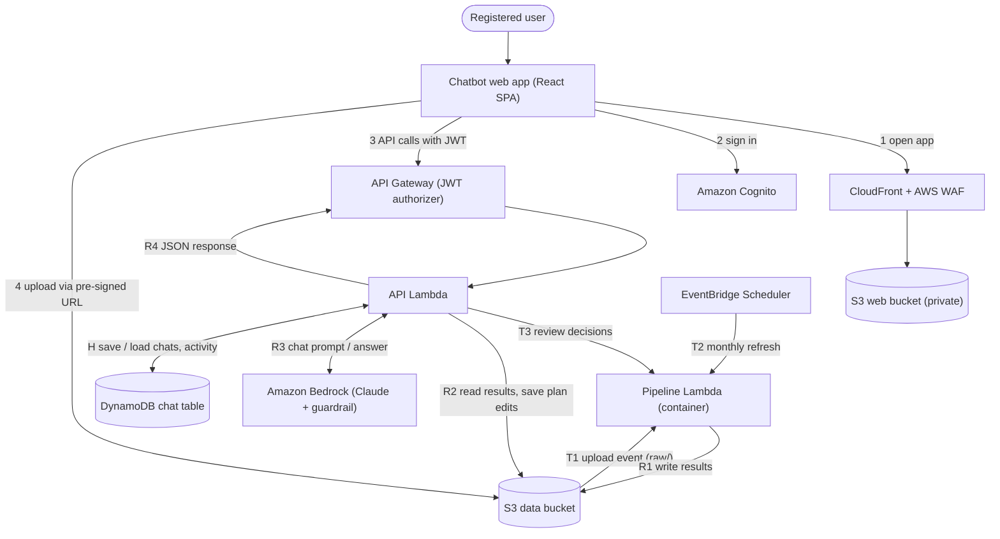

# LPS-Beacon

**Resource Planning Forecast Chatbot** — an AI-powered assistant that turns messy project, pipeline, workforce and
financial planning files into headcount forecasts, supply-versus-demand analysis, resource matching, profit and loss
views and monthly forecast reports, all through a natural-language chat interface.

> Upload your planning files, ask questions in plain English, and get cleaned data, forecasts, charts and
> downloadable reports back in the same conversation.


---

## Table of contents

1. [Project status](#project-status)
2. [Collaborating](#collaborating)
3. [What the chatbot does](#what-the-chatbot-does)
4. [Capabilities and features](#capabilities-and-features)
5. [Roles and access](#roles-and-access)
6. [Example conversations](#example-conversations)
7. [Architecture](#architecture)
8. [How data flows](#how-data-flows)
9. [Data pipeline: cleaning and standardisation](#data-pipeline-cleaning-and-standardisation)
10. [Forecasting approach](#forecasting-approach)
11. [Triggers](#triggers)
12. [Security and access control](#security-and-access-control)
13. [Data storage layout](#data-storage-layout)
14. [API reference](#api-reference)
15. [Chat history model](#chat-history-model)
16. [Estimated cost](#estimated-cost)
17. [Design decisions](#design-decisions)
18. [Getting started](#getting-started)
19. [Repository layout](#repository-layout)
20. [Data handling](#data-handling)
21. [Known limitations](#known-limitations)
22. [Roadmap](#roadmap)

---

## Project status

This repository holds the whole MVP: the web app, the API Lambda and the forecast pipeline Lambda. All of it is
deployed on AWS (`ap-southeast-1`). The AWS resources were set up by hand in the console; there is no
infrastructure-as-code.

| Area | Status | Where |
|---|---|---|
| Sign-in with Amazon Cognito, plus practice accounts for offline work | Built | `src/auth/` |
| Upload (CSV/Excel up to 20 MB each, pre-signed S3 upload, per-file status, optional "upload without review") | Built | `src/pages/UploadPage.tsx`, `POST /upload-url` |
| Review after an upload: Conflicts → Forecast → Matching → publish | Built | `src/review/`, `pipeline/review.py` |
| Chat with the forecast agent (Bedrock Converse with tool use and a guardrail), chat history sidebar with folders | Built | `src/pages/ChatPage.tsx`, `src/components/Sidebar.tsx`, `POST /chat`, `/sessions`, `/folders` |
| Analysis page: capacity plan with shared editable cells, quarter and FY columns, CSV download | Built | `src/pages/AnalysisPage.tsx`, `lambda-api/capacity_plan.py` |
| Dashboard: headcount boxes, capacity plan charts, insights from the uploaded files | Built | `src/dashboard/`, `GET /dashboard`, `GET /dashboard/insights` |
| Activity bell: who uploaded, went through a review step or changed the capacity plan | Built | `src/components/ActivityBell.tsx`, `lambda-api/activity.py` |
| Monthly refresh of the capacity plan inputs and Dashboard insights | Built (EventBridge) | [Triggers](#triggers) |
| Chats deleted 90 days after their last message (DynamoDB TTL) | Built | [Chat history model](#chat-history-model) |
| Leavers, and joiners for past months, from Workday | Waiting on the Workday reports; typed in by hand for now | [Known limitations](#known-limitations) |
| "Run forecast" on demand (`POST /runs/runForecast`, `GET /runs/{id}`) | Not built (the routes answer 501) | `lambda-api/lambda_function.py` |
| Charts inside chat answers, what-if scenarios, email notifications, daily chat limit | Not built | [Roadmap](#roadmap) |
| Authenticator-app (TOTP) MFA setup in the sign-in form | Not supported | [Known limitations](#known-limitations) |

`src/` is inside `LPS-Beacon-Frontend/`, `lambda-api/` is inside `LPS-Beacon_Backend/`, and `pipeline/` is inside
`LPS-Beacon_Backend/lambda-forecastpipeline/`.

---

## Collaborating

The GitHub repository (`GeraldFrontEnd/LPS-Beacon`) is the single source of truth. Nobody needs to zip and send
files: change the code, push, and everyone else pulls the update.

| I want to… | Do this |
|---|---|
| **Work on my own computer** | Clone the repository, then run `npm ci` and `npm run dev` in `LPS-Beacon-Frontend/`. Save a file and the browser updates instantly. |
| **Make a quick edit to a file** | Open the file on GitHub and press the pencil icon, or press `.` for the browser editor. Commit to a new branch and open a pull request. (This edits files; it does not run the app.) |
| **Get the latest changes someone else made** | `git pull` (or **Fetch / Pull** in GitHub Desktop). |

There is no automatic check (CI) on pushes or pull requests, so run `npm run lint` and `npm run build`, and the
backend tests if you changed the backend, before you push. Full instructions are in [Contributing.md](Contributing.md).

---

## What the chatbot does

LPS-Beacon is the single front door for resource planning work. Instead of manually reconciling spreadsheets, a
planner opens the web app, signs in, drops in their files and talks to the assistant.

Behind the chat window, serverless AWS services:

1. **Receive** the uploaded files (one upload of several CSV/XLSX files).
2. **Validate and clean** them: shifted headers, inconsistent names, Excel date serials and wide month columns are
   handled automatically, and rejected files go to quarantine with a reason.
3. **Pause for review** three times: conflicts between files, the resource forecast for each sales-pipeline
   opportunity, and the proposed matches.
4. **Match** demand (quote lines, resource plans and the accepted pipeline demand) against available staff, and turn
   the unmatched demand into a hiring gap.
5. **Forecast** availability and build the capacity plan: headcount, utilisation, revenue, cost and margin by band
   and month, in USD.
6. **Explain** the results in chat with a large language model (Claude on Amazon Bedrock), which reads the published
   run through a fixed set of tools.

The assistant is the **Resource Planning Forecast Agent**: a Bedrock-hosted Claude model that decides which tool to
call (for example the matching summary, the availability forecast, or available resources and unfilled demand) while the numerical work is done by deterministic Python code.
This keeps forecasts repeatable and auditable; the model explains and reasons over the numbers rather than
computing them.

The agent loop runs inside the API Lambda using the Bedrock Converse API with tool use: the Lambda sends the question,
the recent chat history and the tools the user's role may use; Claude asks for a tool; the Lambda runs it and sends
the result back; Claude answers. There is no separate agent service (Bedrock Agents or AgentCore), so the role
check, the tools, the guardrail check and the chat history all live in one place.

---

## Capabilities and features

The tables below describe the **target design**. See [Project status](#project-status) for what exists today.

### 1. Conversational interface

| Feature | Description |
|---|---|
| Natural-language chat | Ask for forecasts, comparisons, explanations and what-if scenarios in everyday language. |
| Suggested questions | One-click starter questions. |
| Rich answers | Replies include rendered charts, forecast tables and data-quality summaries, not just text. |
| Chat history sidebar | Every conversation is saved per user and listed newest-first; open any past chat to reload its messages and re-render its charts. |
| Auto-titled chats | The first message generates a short title (for example, "Grade 7 shortfall Q3"). |
| Rename and delete chats | Users manage their own history; chats expire automatically under a configurable retention period. |
| Run references | Answers cite the forecast run they came from, so every number can be traced back. |

### 2. File upload and ingestion

| Feature | Description |
|---|---|
| Batch uploads | Drag and drop 10–12 CSV/XLSX files at once; the batch is treated as one unit of work. |
| Direct-to-storage upload | Files go straight from the browser to S3 using short-lived pre-signed URLs, so large files never pass through the API. |
| Validation before upload | File type (CSV, XLSX, XLS) and size (20 MB each) are checked in the browser and again on the server. |
| Per-file status | Each file shows ready, uploading, done or error, and the queue survives moving between pages. |
| One run per batch | A `manifest.json` written last signals that the batch is complete, so a 12-file upload triggers one pipeline run, not twelve. |
| Duplicate-file detection | Identical files (matched by SHA-256 fingerprint) are skipped. |
| Format-agnostic detection | Sheets and header rows are found by column signature, not by file name or fixed position. |

### 3. Data cleaning and standardisation

The pipeline is built for noisy planning data, including:

- Header rows that are not on row 1, and extra title or "data as of" rows.
- Several small tables side by side on one sheet.
- Wide month layouts (May…March columns plus a fiscal-year column) that need unpivoting to one row per month.
- Excel serial dates, mixed date formats and hidden or zero-width characters in headers.
- Inconsistent naming (for example "Generic 4" and "Generic Resource 4").
- Exact and business-key duplicates, resolved by the latest modified date.
- Leavers, unknown IT codes and missing grades, which are quarantined rather than silently dropped.

Every run produces a **data-quality report** (what was removed, what was quarantined and why) that appears in the
chat and is passed to the model, so the assistant can say "the Grade 7 gap excludes 12 people with a missing grade".

### 4. Forecasting and analysis

| Capability | What you get |
|---|---|
| **Demand forecast** | Monthly resource demand by grade, skill and location from quote lines, resource plans and pipeline data. |
| **Headcount forecast** | Projected headcount requirement by month and quarter. |
| **Resource matching** | Supply-versus-demand comparison by grade, month and city, with the gap and the people or roles driving it. |
| **Capacity analysis** | Capacity and utilisation trends, bench cost shown separately from project cost, and shortfall or surplus highlights. |
| **Baseline and forecast P&L** | Project margin from ABCD revenue less resource cost, with bench cost shown separately, then a forecast P&L with stated assumptions. |
| **Monthly and quarterly forecasts** | Scheduled runs on the latest cleaned data, including a quarter-horizon view. |
| **What-if scenarios** | Change an assumption in chat (add hires, slip a project, change a start date) and get the result as a delta against the baseline. |
| **Stated assumptions** | Forecasts list the assumptions and data limits behind them; thin history is flagged, and synthetic data, where used, is clearly marked. |

### 5. Reports and notifications

| Feature | Description |
|---|---|
| Monthly forecast report | Excel and CSV outputs written to storage for each run (PDF is on the roadmap). |
| In-chat results | The same forecast table and charts, rendered in the conversation. |
| Email notifications | Run complete, shortfall detected, stale-data reminder and failure alerts, sent through Amazon SNS with a link back to the app. |
| Audit trail | Accept, edit and reject actions on a forecast are logged with user and timestamp. |

### 6. Security and administration

- Email and password sign-in through Amazon Cognito, with **required authenticator-app MFA** in the target design.
- Two kinds of account (Cognito groups `restricted` and `finance_hr`, see [Roles and access](#roles-and-access)). The web
  app hides pages by role, but access control is enforced by the backend.
- Per-user data isolation: uploads and chat history are scoped by the verified user ID.
- AWS WAF in front of the app, least-privilege IAM per function, encrypted private buckets and a full CloudTrail
  audit trail.
- Per-user daily chat limit and a monthly spend alert to keep model costs predictable.

---

## Roles and access

There are two kinds of account. The role comes from the user's Cognito group: `restricted` or `finance_hr`
(if someone is in both, Finance/HR wins).

| Page | Restricted (mainly project managers) | Finance/HR |
|---|:---:|:---:|
| Chat | Yes (limited questions, see below) | Yes |
| Dashboard | No | Yes |
| Upload files | No | Yes |
| Analysis | No | Yes |

The rules are set in one place, `LPS-Beacon-Frontend/src/auth/permissions.ts`. Screen rules are a convenience only. The backend
must withhold cost and capacity plan data from anyone outside the `finance_hr` group, and the chat backend should apply a
Bedrock guardrail to `restricted` users to limit the questions they can ask.

---

## Example conversations

```
You:    Upload complete — 11 files.
Beacon: Cleaned 11 files. Removed 57 duplicate rows and 1 duplicate file, quarantined
        55 records with unknown IT codes. Forecast is ready.

You:    Where are we short on headcount next quarter?
Beacon: Grade 7 is short by 6 FTE in Feb–Mar, mainly driven by two projects starting in
        January. Grades 4–5 are in surplus by 3 FTE. [chart] [table]

You:    What if three Grade 7 hires start in January and Project X slips two months?
Beacon: The Grade 7 gap closes in February instead of April, but bench cost rises by
        about 8% in Q4. Compared with the baseline: [delta chart]

You:    Why did the gap grow in March?
Beacon: Two quote lines (Q-1042, Q-1057) start in March, adding 4 FTE of Grade 7
        demand while three people on the staff list have leave dates before then.

You:    Send me the monthly report.
Beacon: Here is the Excel report for this run. [download]
```

These examples are illustrative. The numbers and project names are not real data.

---

## Architecture

The design is deliberately small: **serverless, pay-per-use, nothing running between requests.**



The diagram above is the current system. [`docs/architecture.svg`](docs/architecture.svg) and the editable
[`docs/architecture.drawio`](docs/architecture.drawio) show the original design, which also had SNS emails, Bedrock
narratives in the pipeline and API calls through CloudFront; none of those are in use.

### Components

| Component | Role |
|---|---|
| **Chatbot web app** | React single-page app: chat with a history sidebar, upload with the review drawer, Dashboard, Analysis (capacity plan) and the activity bell. Hosted in a private S3 bucket behind CloudFront. |
| **Amazon CloudFront + AWS WAF** | HTTPS entry point for the web app. WAF filters bad IPs, common exploits and request floods. |
| **Amazon Cognito** | User pool `lps-beacon`: email and password sign-in; issues the JWT used on every API call. Two groups, `finance_hr` and `restricted`. |
| **API Gateway (HTTP API)** | `9dpaon3lz7`. Routes API calls; the JWT authorizer rejects unauthenticated calls. The web app calls its `execute-api` URL directly, not through CloudFront. |
| **API Lambda** | `lps-beacon-apilambda`, Python 3.12, standard library and boto3 only: pre-signed upload links, upload status and review steps, the chat agent and history, the capacity plan, the Dashboard and the activity bell. Takes the user ID only from the verified token. |
| **Pipeline Lambda** | `lambda-forecastpipeline`, container image (pandas, openpyxl, scipy, scikit-learn): validation, cleaning, the review steps, matching, the availability forecast, capacity plan inputs, Dashboard insights and publishing. 3008 MB, 5-minute timeout, reserved concurrency 1. |
| **Amazon S3 (data)** | Bucket `lps-beacon-data`: `raw/`, `quarantine/`, `clean/`, `curated/`, `results/` and `plan/` prefixes (see [Data storage layout](#data-storage-layout)). |
| **Amazon Bedrock** | Claude Haiku 5.5 for chat, called through an inference profile (`CHAT_MODEL_ID`), with a Bedrock Guardrail on every question and answer. Receives tool results (aggregates), not raw rows. |
| **Amazon DynamoDB** | Table `lps-beacon-chat`: chat sessions, messages and folders, and the activity bell. On demand, with TTL on `expiresAt`. |
| **EventBridge Scheduler** | `lps-beacon-monthly-forecast`: 09:00 SGT on the 1st, refreshes the capacity plan inputs and Dashboard insights. |
| **Amazon SNS** | Supported by the pipeline code (published and failed emails), but no topic is configured, so no emails are sent. |
| **IAM, CloudWatch, CloudTrail, ECR** | Least-privilege roles, logs and alarms, audit trail, container image storage. |

---

## How data flows

Numbers on the architecture diagram map to these steps.

**Requests and uploads**

| Step | What happens |
|---|---|
| 1 | The user opens the app through CloudFront; WAF filters the traffic. |
| 2 | The user signs in with email and password; Cognito returns a JWT. |
| 3 | The app calls API Gateway with the JWT; the authorizer validates it, and the API Lambda checks the user's group. |
| 4 | `POST /upload-url` returns a pre-signed URL per file, under `raw/{user_sub}/{yyyy-mm-dd}/{batch_id}/`. The browser PUTs each file straight to S3. |

**Review**

| Step | What happens |
|---|---|
| **T1** | Each file starts the Pipeline Lambda, which validates and cleans it and updates `results/uploads/.../status.json`. |
| **V1** | After the last file of the upload, the pipeline pauses at each review step (conflicts, opportunity forecast, matching). The upload page polls the status file. |
| **T3** | Each decision goes to the API Lambda, which starts the pipeline again with `{"mode": "review", ...}`. After the matching step, the run is published. |

**Results back to the user**

| Step | What happens |
|---|---|
| **R1** | The Pipeline Lambda writes `results/{run_id}/` (summary, detail, finance, `manifest.json`, an Excel download), then `results/latest.json`, which points at the newest run. It also rebuilds `results/capacity/inputs.json` and the Dashboard insights. |
| **R2** | The API Lambda reads the latest results for the chat tools, the capacity plan and the Dashboard. Capacity plan edits are saved to `plan/edits.json`. |
| **R3** | The API Lambda sends the question, the recent chat history and the allowed tools to Bedrock, runs the tools the model asks for, and returns the answer. |
| **R4** | The JSON response returns API Lambda → API Gateway → web app, which renders the reply. |

**Chat history**

| Step | What happens |
|---|---|
| **H1** | On page load, `GET /sessions` lists the user's chats from DynamoDB for the sidebar. |
| **H2** | Each `/chat` call saves the question and answer, and moves the chat's expiry to 90 days from now. |
| **H3** | Opening a past chat reloads its messages. |

---

## Data pipeline: cleaning and standardisation

The Pipeline Lambda runs these stages. A typical upload takes about 20 to 40 seconds of processing, plus the pauses
for the user's review.

| # | Stage | What it does | Code |
|---|---|---|---|
| 1 | **Validate** | Extension, real size and content, zip-bomb and macro checks. Rejected files go to `quarantine/` with a reason. | `pipeline/validate.py` |
| 2 | **Clean** | Recognises each dataset by its headers, standardises it and writes `clean/<dataset>/`. Months missing from a source are "no data", not zero. | `pipeline/clean.py` |
| 3 | **Review: conflicts** | The same quote line or project role with a different grade in two files; the user picks one. | `pipeline/crossval.py` |
| 4 | **Review: opportunity forecast** | The roles, bands and months each SFDC opportunity needs: from its own SL x RP plan (CRM ID), else a similar past ABCD project, else entered by hand. | `pipeline/opportunities.py` |
| 5 | **Review: matching** | `matching_python_script.py` proposes people for the demand lines; the user accepts, swaps or rejects. Unmatched demand becomes the hiring gap (`summary/hiring_gap.json`). | `pipeline/matching.py`, `pipeline/review.py` |
| 6 | **Forecast** | Availability forecast: who becomes free and what demand starts, by role and month, with renewals and fiscal roll-ups. | `pipeline/forecast.py` |
| 7 | **Publish** | `results/<run_id>/` and `results/latest.json`, then the capacity plan inputs and the Dashboard insights. | `pipeline/publish.py`, `pipeline/capacity.py`, `pipeline/insights.py` |

With `REVIEW_ON_UPLOAD=false`, or an "upload without review", the review stages are skipped. Each file's role is
described in [`LPS-Beacon_Backend/lambda-forecastpipeline/README.md`](LPS-Beacon_Backend/lambda-forecastpipeline/README.md).

**Why Python in Lambda instead of AWS Glue or Athena?** The data is small, pandas reads `.xlsx` directly, Lambda
starts instantly and costs fractions of a cent per run, and there are no jobs, crawlers or catalog tables to
maintain. Revisit Glue/Athena only if a batch reaches hundreds of megabytes or millions of rows.

### Planning inputs

| Input | Used for |
|---|---|
| **Project resource plan** | Supply and demand for matching and the availability forecast |
| **Quote line** | Demand for matching |
| **Position Name Mapping** | Maps position names to roles for matching (names missing from it show as UNMAPPED) |
| **SFDC pipeline** | The opportunity forecast (review step 2) and the Dashboard's sales pipeline |
| **ABCD report** | Similar past projects for the opportunity forecast |
| **SL × RP report** | An opportunity's own resource plan, found by CRM ID |
| **BU UR report** | Actual utilisation for the capacity plan and the Dashboard |
| **Staff list** | Headcount today and upcoming leavers on the Dashboard |
| **Rates** (optional) | Daily rate and cost per grade |

`HC by HR` and the HeadCount MBR file are accepted but not used yet.

---

## Forecasting approach

- **The model does not do the maths.** Matching, the availability forecast and the capacity plan are deterministic
  Python rules and formulas, so the same inputs always give the same numbers.
- **The agent explains and reasons.** Claude receives tool results from the latest published run and explains
  drivers, flags gaps and answers "why" questions.
- **Tool use, not free-form queries.** The agent can only call a fixed set of tools (`get_matching_summary`,
  `get_availability_forecast`, `find_available_resources`, `count_resources`, `count_unfilled_demand`,
  `find_unfilled_demand`). It never writes arbitrary queries against the data.
- **Tools depend on the role.** `restricted` users get a system prompt that withholds cost, rate, revenue, margin and
  salary information, and the Lambda only runs the tools the caller's group may use, even if the model asks for others.
- **Guardrail on both sides.** The Lambda checks the question and the answer with a Bedrock Guardrail
  (`ApplyGuardrail`) for prompt attacks, harmful content and personal data.
- **Honest about limits.** Months missing from a source are reported as "no data", not zero.

---

## Triggers

| ID | Trigger | Runs |
|---|---|---|
| **T1** | Files land under `raw/` (one S3 event per file) | Validate and clean each file; after the last file of the upload, the review |
| **T2** | Monthly schedule `lps-beacon-monthly-forecast`, 09:00 SGT on the 1st, payload `{"mode": "dashboard_data"}` | Rebuilds `results/capacity/inputs.json` and the Dashboard insights only |
| **T3** | A review decision, or a review of the stored data (`POST /pipeline/reviews`), sent by the API Lambda | The next review step |

Reserved concurrency of 1 means two runs never write `results/` at the same time. There is no quarterly schedule.
The fiscal year runs April to March (`pipeline/fiscal.py`).

**Never schedule `{"mode": "full"}`.** It publishes without the review, overwrites `results/latest.json` and resets
the capacity plan's joiners to 0, because a run without a review has no hiring gap.

---

## Security and access control

| Layer | Control |
|---|---|
| **Identity** | Cognito user pool `lps-beacon`, email + password; every user is in the `finance_hr` or `restricted` group. The sign-in form can't complete authenticator-app (TOTP) MFA yet, so MFA can't be required (see [Known limitations](#known-limitations)). |
| **API** | JWT authorizer on every route; issuer and audience pinned to this user pool and app client. The API Lambda checks the group on every route. |
| **Edge** | AWS WAF on CloudFront: managed core rule set, IP reputation list and a per-IP rate limit; Shield Standard DDoS protection included. |
| **Uploads** | Pre-signed URLs expire after 5 minutes, are scoped to `raw/{user_sub}/` and are only issued to `finance_hr`. The pipeline then checks the real file type and size, zip bombs and macros. |
| **Data** | Private buckets, Block Public Access, TLS-only bucket policy, default encryption; raw uploads auto-expire after 30 days. |
| **Isolation** | The API Lambda derives the user ID from the verified JWT only, never from the request body. |
| **Least privilege** | One IAM role per function; only the API Lambda touches the chat table. |
| **AI safety** | Fixed tool set per role, server-side system prompt, Bedrock Guardrail on the question and the answer, and tool results (aggregates) instead of raw rows sent to the model. |
| **Input safety** | Cells are read as values (never evaluated as formulas); leading `=`, `+`, `-`, `@` are neutralised in any export. |
| **Audit** | The activity bell records who uploaded, went through a review step or changed the capacity plan, and when (kept 90 days). CloudTrail for API and S3 data events. |
| **Cost guardrails** | Not built yet: a per-user daily chat cap and an AWS Budgets alert are planned. |

**CORS:** the web app calls API Gateway on its own domain and uploads to S3 on another, so both need CORS. API
Gateway's CORS settings allow the app's origin, and the data bucket has a CORS rule that allows `PUT` from the app's
exact origin.

---

## Data storage layout

```
s3://lps-beacon-data/
├── raw/{user_sub}/{yyyy-mm-dd}/{batch_id}/   # original uploads, never changed
├── quarantine/                               # rejected files + <file>.reason.json
├── clean/{dataset}/                          # latest cleaned table per dataset, quality report, history
├── curated/matching|forecast|finance/        # stage outputs per run, plus latest/
├── results/{run_id}/                         # summary/, detail/, finance/, manifest.json, Excel download
├── results/latest.json                       # pointer to the newest published run (written last)
├── results/uploads/{user}/{date}/{batch_id}/status.json   # upload and review progress
├── results/capacity/inputs.json              # capacity plan inputs
├── results/dashboard/                        # Dashboard insights
└── plan/edits.json                           # shared capacity plan edits (last write wins)
```

**Do not empty this bucket.** `clean/`, `curated/`, `results/` and `plan/` are live state. `results/latest/` is an
old CSV fallback: always resolve `results/latest.json` instead. The full list is in
[`DEPLOY.md`](LPS-Beacon_Backend/lambda-forecastpipeline/DEPLOY.md#folders-written-in-lps-beacon-data).

---

## API reference

All routes require a valid Cognito JWT (`Authorization` header). The web app lists them in `API_ROUTES` in
`LPS-Beacon-Frontend/src/api/client.ts`; they are handled in `LPS-Beacon_Backend/lambda-api/lambda_function.py`.
Request and response shapes are in [`LPS-Beacon-Frontend/API_CONTRACT.md`](LPS-Beacon-Frontend/API_CONTRACT.md).

| Method | Path | Who | Purpose |
|---|---|---|---|
| `POST` | `/upload-url` | `finance_hr` | Pre-signed upload link for one file; all files of one upload share a `batchId` |
| `GET` | `/pipeline/uploads/{date}/{batchId}` | `finance_hr` | Progress of one upload (the pipeline's status file) |
| `GET` | `/pipeline/uploads/{date}/{batchId}/review/{step}` | `finance_hr` | What the review shows for `conflicts`, `forecast` or `matching` |
| `POST` | `/pipeline/uploads/{date}/{batchId}/review/{step}` | `finance_hr` | The user's decisions; starts the next step |
| `POST` | `/pipeline/reviews` | `finance_hr` | Review the data already uploaded, without new files |
| `POST` | `/chat` | signed in | Agent answer, saved to the chat history |
| `GET` | `/sessions` | signed in | The caller's chats, newest first |
| `GET` | `/sessions/{id}/messages` | signed in | One chat's messages |
| `PATCH` / `DELETE` | `/sessions/{id}` | signed in | Rename or move a chat to a folder, or delete it with its messages |
| `GET` / `POST` | `/folders` | signed in | List folders (the first call creates the default ones), or create one: `{ id, name }` |
| `PATCH` / `DELETE` | `/folders/{id}` | signed in | Rename a folder, or delete it (its chats move back to the main list) |
| `GET` | `/analysis` | `finance_hr` | The capacity plan |
| `PATCH` | `/analysis` | `finance_hr` | Edit one input cell and get the whole plan back (`null` removes the edit) |
| `DELETE` | `/analysis/edits` | `finance_hr` | "Clear my edits": removes only the caller's edits |
| `GET` | `/dashboard` | `finance_hr` | Headcount breakdown for the Dashboard boxes (204 before a staff list is uploaded) |
| `GET` | `/dashboard/insights` | `finance_hr` | Dashboard charts from all the uploaded files (204 before the first build) |
| `GET` | `/activity` | `finance_hr` | The activity bell: latest events, and how many the caller hasn't seen |
| `POST` | `/activity/seen` | `finance_hr` | The caller opened the bell; clears their red dot |
| `POST` | `/runs/runForecast` | `finance_hr` | Not built: answers 501 |
| `GET` | `/runs/{id}` | `finance_hr` | Not built: answers 501 |

A new route has to be added in API Gateway (`9dpaon3lz7`, with the JWT authorizer) as well as in the code.

---

## Chat history model

A single on-demand DynamoDB table, `lps-beacon-chat`, with generic keys `PK` and `SK` (both strings), so sessions,
messages, folders and the activity bell share one table. TTL is on, using the attribute `expiresAt`.

| Record | `PK` | `SK` | Holds |
|---|---|---|---|
| Session | `USER#{sub}` | `SESSION#{id}` | Title, folder (`projectId`), `createdAt`, `updatedAt`, linked run IDs, `expiresAt` |
| Message | `USER#{sub}#SESSION#{id}` | `MSG#{timestamp}#{random}` | Role (`user` / `assistant`), text, referenced run or chart IDs, `expiresAt` |
| Folder | `USER#{sub}` | `FOLDER#{id}` | Folder name, `createdAt` |
| Folder marker | `USER#{sub}` | `META#folders` | Records that the default folders were created, so deleting them all does not bring them back |
| Activity event | `ACTIVITY` | `EVT#...` | Who uploaded, went through a review step or changed the capacity plan, and when (kept 90 days) |
| Activity grouping | `ACTIVITY` | `OPEN#...` | Groups capacity plan edits less than 15 minutes apart, and all files of one upload, into one entry |
| Activity seen | `USER#{sub}` | `META#activity-seen` | When the user last opened the bell |

`{sub}` is the user's Cognito ID, taken only from the verified token, never from the request. `{id}` for a session is
the chat ID the web app creates; there is no `POST /sessions`, so the first `POST /chat` with a new ID creates the
session record.

Why the keys look like this:

- **The user ID is part of every key a user can reach.** A chat can only be found by someone whose `sub` is in its
  key, so one user cannot read or change another user's chat even if a route forgets an ownership check. A request for
  someone else's chat finds nothing and gets 404.
- **Sessions are fetched directly by ID.** `GET /sessions/{id}/messages`, `PATCH` and `DELETE /sessions/{id}` know
  only the ID, so the session key is `SESSION#{id}` with nothing else in it: one `GetItem`, no search.
- **The sidebar is one query.** `GET /sessions` queries `PK = USER#{sub}` and `SK begins_with SESSION#`, then the
  Lambda sorts by `updatedAt`, newest first. A user has tens of chats, so sorting in the Lambda costs nothing; if that
  ever reaches thousands, add a secondary index on `updatedAt`.
- **Messages come back in order.** Querying `PK = USER#{sub}#SESSION#{id}` returns them sorted by timestamp; the
  random suffix keeps two messages in the same millisecond from overwriting each other.
- **Deleting a chat** deletes the session record and its messages. **Expiry:** every new message moves the whole chat
  (the session and all its messages) to 90 days from now (`CHAT_RETENTION_DAYS`, default 90), and TTL deletes it
  after that.

Large data stays in S3; DynamoDB holds small records and pointers. Only the API Lambda may read or write this table,
and its IAM permission is scoped to this table's ARN.

---

## Estimated cost

Region: `ap-southeast-1` (Singapore). Public list prices; excludes tax, support plan, SMS MFA and a custom domain.
These are design-time estimates, not measured spend. The Sonnet 5.5 narrative line no longer applies, because the
pipeline does not call Bedrock. Check AWS Cost Explorer for real costs.

| Service | Usage basis (pilot / growth) | Pilot | Growth |
|---|---|---|---|
| Bedrock, Haiku 5.5 chat | 600 / 6,000 messages × 6k input + 0.5k output tokens | $0.51 | $5.10 |
| Bedrock, Sonnet 5.5 narratives | 20 / 60 runs × 12k input + 1.5k output tokens | $0.78 | $2.34 |
| AWS WAF | Web ACL + 3 rules + requests | $8.05 | $8.30 |
| S3 | 5 / 50 GB + requests | $0.15 | $1.30 |
| ECR | ~1 GB container image | $0.10 | $0.10 |
| API Gateway, DynamoDB, CloudTrail | ~3.5k / 35k API calls; small tables | $0.05 | $0.10 |
| Lambda | Inside the always-free tier | $0 | $0 |
| CloudFront, Cognito, CloudWatch, SNS, Scheduler, Budgets | Inside free tiers | $0 | $0 |
| **Total per month** | | **≈ $9.64** | **≈ $17.24** |

Pilot = 20 users, 30 chats per user, 20 pipeline runs. Growth = 200 users, 6,000 chats, 60 runs.

**Cost notes**
- Model prices are Bedrock list prices in Singapore: Haiku 5.5 is $0.10 / $0.50 and Sonnet 5.5 is $2.00 / $10.00 per
  million input / output tokens. Haiku 5.5 is a tenth of the price of Haiku 4.5 ($1.00 / $5.00).
- Bedrock chat is the main variable cost (about $0.85 per extra 1,000 messages); the per-user daily cap is the most
  effective control.
- Haiku 5.5 also has a "Long Context" price at five times the normal rate, which applies only to very long prompts.
  Sending a results summary and the last ~10 turns of the chat, not the whole history, keeps every call at the normal
  rate.
- WAF is the main fixed cost. If your account is eligible for CloudFront flat-rate plans, the Free plan bundles WAF
  and removes that line.
- Attaching a separate regional web ACL to the Cognito user pool (to rate-limit sign-in and sign-up) adds roughly
  $7 per month; it is optional for invite-only pilots.

---

## Design decisions

How this design relates to the original draft architecture:

| Original draft | Current design | Why |
|---|---|---|
| SQS notification queue | S3 event per uploaded file; the last file of an upload starts the run | One run per upload, no queue to manage |
| Upload processing Lambda | API Lambda (pre-signed URLs) + Pipeline Lambda | Browser uploads straight to S3; validation happens before the URL is issued |
| AWS Glue ETL (Lambda) | Pipeline Lambda (pandas) | Data is small; Glue adds startup time, minimum billing and setup |
| Processed S3 buckets | One data bucket with prefixes | Fewer buckets, same stage separation |
| Athena query engine | Cleaned tables (compressed JSON in S3) read directly in the pipeline | No catalog or query service needed at this scale |
| Forecast Agent Lambda / Bedrock | Forecast module in the Pipeline Lambda; Bedrock explains the results in chat | Deterministic maths, LLM explanation |
| Report Generation Lambda | The publish stage writes an Excel download into `results/{run_id}/` | One fewer function and trigger |
| SNS notification | SNS email | Supported in the pipeline code, but no topic is configured yet |
| "Chatbot returns user prompt queries" | R1–R4 return path + chat history in DynamoDB | Results, charts and history come back through the same API |

---

## Getting started

### Run the web app locally (mock mode, no AWS account needed)

Requires Node.js 22, 24 or 26 on a patched release: at least 22.23.4, 24.22.1 or 26.12.1 (CSA alert AL-2026-154). Vite itself
accepts 20.19+ or 22.12+, but Node 20 no longer gets security fixes. Check with `node -v`.

```bash
cd LPS-Beacon-Frontend
npm ci
```

Create `LPS-Beacon-Frontend/.env` containing the line `VITE_USE_MOCK=true`, then run `npm run dev`. There is no
template file; every setting is listed in [`LPS-Beacon-Frontend/README.md`](LPS-Beacon-Frontend/README.md#configuration).

Sign in with a practice account: `finance@demo.com` (Finance/HR) or `restricted@demo.com` (restricted), password
`demo123`. To edit code and share changes with others, see [Contributing.md](Contributing.md).

### Connect the web app to AWS

1. In `LPS-Beacon-Frontend/.env`, set `VITE_USE_MOCK=false` and `VITE_USE_MOCK_AUTH=false`, plus `VITE_API_URL` (the
   API Gateway `execute-api` URL), `VITE_COGNITO_USER_POOL_ID` and `VITE_COGNITO_CLIENT_ID`. The Cognito app client
   must be public, with no secret.
2. Build and publish: see [Deploying the web app](LPS-Beacon-Frontend/README.md#deploying-the-web-app).

### Deploy the backend

Everything was set up by hand in the AWS console (Singapore, `ap-southeast-1`).

- **Pipeline Lambda:** build the container image and follow
  [`DEPLOY.md`](LPS-Beacon_Backend/lambda-forecastpipeline/DEPLOY.md). Pushing a new tag to ECR does not update the
  function: deploy the new image in the Lambda console, and if in doubt compare the function's image digest with ECR.
- **API Lambda** (`lps-beacon-apilambda`, Python 3.12): paste `lambda_function.py`, `capacity_plan.py` and
  `activity.py` from `LPS-Beacon_Backend/lambda-api/` into the console and click **Deploy**. It uses only the
  standard library and boto3.
- **New API routes** also have to be added in API Gateway (`9dpaon3lz7`) with the JWT authorizer.

API Lambda settings (Lambda → Configuration → Environment variables). The full list, with the IAM permissions, is at
the top of `lambda-api/lambda_function.py`:

```
DATA_BUCKET=lps-beacon-data
BUCKET_REGION=ap-southeast-1
CHAT_TABLE=lps-beacon-chat
CHAT_MODEL_ID=<Bedrock inference profile ID for Claude Haiku 5.5>
GUARDRAIL_ID=<Bedrock Guardrail ID>
GUARDRAIL_VERSION=<guardrail version>
PIPELINE_FUNCTION=lambda-forecastpipeline
CHAT_RETENTION_DAYS=90   # optional; 90 is the default
```

The pipeline's settings are in `DEPLOY.md`, Step 7.

### Run the backend tests

```bash
cd LPS-Beacon_Backend/lambda-forecastpipeline
pip install -r requirements-dev.txt
python -m unittest discover -s tests -v
```

The API Lambda has its own tests in `LPS-Beacon_Backend/lambda-api/tests/`.

---

## Repository layout

```
LPS-Beacon/
├── README.md
├── Contributing.md               # how to edit, share and review changes
├── .gitignore                    # secrets, planning data (Excel, CSV), Node, Python, editors
├── docs/
│   ├── architecture.svg          # original design diagram
│   ├── architecture.drawio       # editable version
│   ├── vite-template-notes.md    # the original Vite template README
│   └── Project_2_POC_UserStories_UseCases_v0.7.docx
├── LPS-Beacon-Frontend/          # the web app (React 19, TypeScript, Vite)
│   ├── src/
│   │   ├── analysis/             # capacity plan layout, number formatting, CSV export
│   │   ├── api/                  # client.ts (every backend call, mock + real), types.ts, sample plan
│   │   ├── auth/                 # Cognito / practice sign-in, roles (permissions.ts)
│   │   ├── charts/               # bar, line and heatmap charts
│   │   ├── chats/                # chat history and export
│   │   ├── components/           # NavBar, Sidebar, ActivityBell, MessageList, MessageInput, FileList, dialogs
│   │   ├── dashboard/            # Dashboard sections, KPI boxes, insights
│   │   ├── pages/                # Chat, Dashboard, Upload, Analysis, Login
│   │   ├── review/               # the upload review: Conflicts, Forecast, Matching
│   │   ├── theme/
│   │   ├── uploads/              # upload queue shared across pages
│   │   └── App.tsx, main.tsx, index.css
│   ├── public/
│   ├── scripts/deploy.mjs        # build + publish to S3 and CloudFront
│   ├── API_CONTRACT.md           # what the app expects from the backend
│   ├── package.json, package-lock.json, vite.config.ts, tsconfig*.json, eslint.config.js, index.html
│   └── README.md
└── LPS-Beacon_Backend/
    ├── lambda-api/               # API Lambda: lambda_function.py (router), capacity_plan.py, activity.py, tests/
    └── lambda-forecastpipeline/  # Pipeline Lambda (container image): pipeline/, matching scripts, tests/,
                                  # Dockerfile, build.ps1, run_local.py, README.md, DEPLOY.md
```

Not in Git: `.env` and `.env.deploy` (your settings), `node_modules/`, `dist/` and any planning data.

---

## Data handling

This project processes HR headcount, staff cost and project revenue data.

- **Never commit real planning files.** `.gitignore` blocks Excel files (`*.xlsx`, `*.xls`, `*.xlsm` and the other
  Excel types) and `*.csv` everywhere. There is no sample-data folder in the repository.
- Anonymise before sharing a sample: replace names, IT codes, project names and amounts.
- **Never commit `.env` or `.env.deploy`.** `.gitignore` blocks both. There are no template files; the variable names
  are in `LPS-Beacon-Frontend/README.md`.
- The frontend bucket and CloudFront distribution ID used by `npm run deploy` are read from
  `LPS-Beacon-Frontend/.env.deploy`, not stored in the repository.
- If a secret or real data file is committed by mistake, treat it as exposed: rotate the credential and remove the
  file from the whole Git history, not just the latest commit.

---

## Known limitations

- **Leavers are 0 in the capacity plan unless typed in by hand**, and so are joiners for past months. Both need the
  Workday joiner and leaver reports, which haven't arrived. Joiners for forecast months come from the hiring gap of
  the last review; a run that skipped the review has no hiring gap, so its joiners are 0.
- **MFA setup is not supported in the web app's sign-in form.** If the Cognito user pool requires MFA and the user
  has not enrolled an authenticator app, sign-in stops with "An extra sign-in step is required
  (CONTINUE_SIGN_IN_WITH_TOTP_SETUP)". Use Amplify's `<Authenticator>` component or handle the step with
  `confirmSignIn()` before relying on required MFA. See `LPS-Beacon-Frontend/src/auth/authService.ts`.
- Users who must change their temporary password are told to ask an administrator to set a permanent one.
- **The activity bell logs what was asked for**, not whether the pipeline finished it. Logging the outcome needs the
  pipeline Lambda to get DynamoDB access.
- **"Run forecast" on demand is not built:** `POST /runs/runForecast` and `GET /runs/{id}` answer 501.
- **No email notifications:** no SNS topic is configured.
- **No daily chat limit or Bedrock budget alert** yet.
- **No mobile layout.**
- **No automatic checks (CI)** on pushes or pull requests.
- Practice accounts (`DEMO_ACCOUNTS`) should be removed before a production release.

---

## Roadmap

- Workday joiner and leaver reports feeding the capacity plan (typed-in edits still override).
- Daily chat limit and a Bedrock budget alert.
- Pipeline outcomes (published / failed) in the activity bell.
- Handle MFA setup and code entry in the sign-in flow.
- "Run forecast" on demand.
- Charts in chat answers and what-if scenarios.
- Email notifications (an SNS topic and `ALERT_TOPIC_ARN`).
- An automatic check (CI) that runs lint, type-check, build and the backend tests on every pull request.
- Glue/Athena (or another warehouse) if batches grow beyond what Lambda handles comfortably.
- A Bedrock Knowledge Base if the assistant needs to cite policy documents and rate cards.
- Moving the agent to Bedrock AgentCore if the client later needs managed agent hosting.

---

## License

No license has been chosen yet. Until one is added, all rights are reserved by the project owner.
